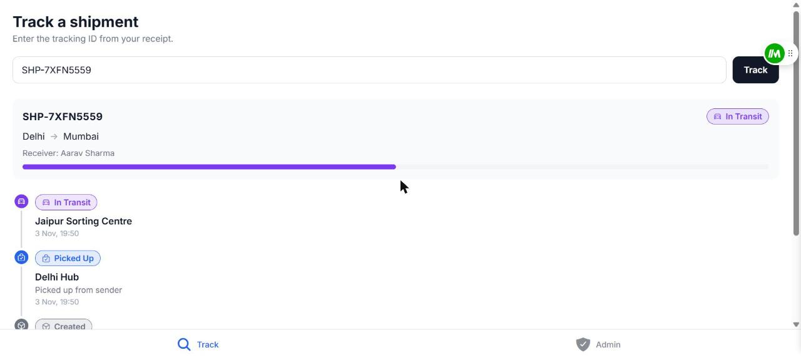
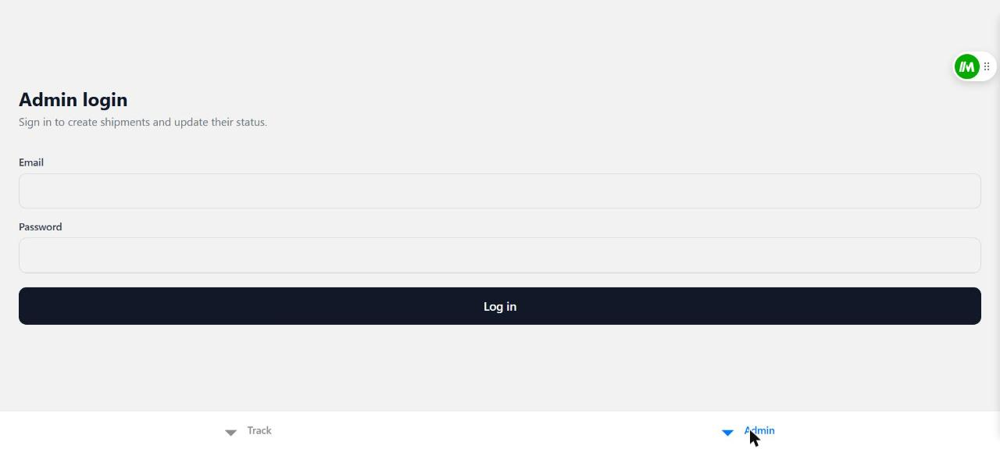

# Shipment Tracker

A courier-tracking app (think Delhivery / Blue Dart): anyone can look up a parcel by tracking ID and see its timeline; staff log in to create, edit and advance shipments (admins can do everything, drivers can only update status). Login can be switched off with `REQUIRE_ADMIN=false` for an open demo. Built as a full-stack TypeScript monorepo — **GraphQL API + React Native (Expo) app** that runs on Android, iOS and web.

> **Live demo:** _TODO — add Netlify URL after deploy_ · **Android APK:** _TODO — add GitHub Release link_
> The API runs on a free Render instance and sleeps when idle — the first request can take 30–50 s to wake it.

| Track | Admin |
|---|---|
|  |  |

_Demo GIF: TODO._

## Stack

| Layer | Tech |
|---|---|
| API | Node, Express 5, Apollo Server 5, GraphQL, Mongoose 8, MongoDB |
| Auth | JWT (HS256, 8h) + bcrypt |
| App | Expo (React Native), TypeScript, Apollo Client 4, React Navigation (bottom tabs), Reanimated |
| Tests | API: Jest, ts-jest, mongodb-memory-server. App: jest-expo, Testing Library |
| Tooling | pino (structured logs), graphql-codegen (app types generated from the API schema), GitHub Actions CI |
| Deploy | MongoDB Atlas, Render (API), Netlify (web), EAS (APK) |

## Features

- **Public:** `shipment(trackingId)` query → current status + full timeline.
- **Admin (JWT login by default):** `createShipment`, `updateStatus`, and `shipments(status, search, cursor, limit)` — a cursor-paginated list. Set `REQUIRE_ADMIN=false` on the API to make them open for demos; the public `authRequired` query tells the app whether to show the login form.
- **Shipment details (all optional):** sender name, receiver phone, package type, weight, description and an **estimated delivery date**. The Track screen shows "Arriving tomorrow" / "Arriving by Sat, 9 Nov" (red when running late) and "Delivered on ..." once done. Shipments created before these fields existed still work. The receiver's phone is masked (last 4 digits) for everyone except a logged-in admin, because a tracking ID is not a secret.
- **Abuse protection:** per-IP rate limit on `/graphql` (300 / 15 min) and a much tighter one on `login` (10 / 15 min), plus a query depth limit.
- **Status state machine:** a main path `CREATED → PICKED_UP → IN_TRANSIT → OUT_FOR_DELIVERY → DELIVERED`, one step at a time, plus exceptions: `DELAYED`, `ON_HOLD`, `DELIVERY_ATTEMPT_FAILED`, `RETURNED`, `CANCELLED`. Each exception needs a written reason (shown on the Track screen). `DELAYED`/`ON_HOLD` resume where the parcel left off, a failed attempt can be retried, `DELIVERED`/`RETURNED`/`CANCELLED` are final. Illegal moves are rejected with `INVALID_STATUS_TRANSITION`. The API exposes `allowedNextStatuses` on each shipment, so the app never duplicates the rules.
- Status history is append-only.
- **Roles:** `ADMIN` (everything) and `DRIVER` (look up shipments and update status; nothing else). Checked against the database on every request, so removing a user takes effect immediately. Fields are masked per role: the receiver's phone, the delivery code and the audit trail are never sent to people who shouldn't see them.
- **Proof of delivery:** marking a parcel `DELIVERED` needs the name of who received it, and, when login is required, the receiver's 4-digit **delivery code** (shown to admins, read out by the receiver at the door). A photo upload would need file storage, so a name and a code stand in for it.
- **Edit and audit trail:** admins can correct a shipment's details; every change is logged with who, when and old value to new value. Each status event also records who made it.
- **Dashboard:** counts by status, shipments created per day, and the ones that need attention (delayed, on hold, failed attempt, or past their estimate).
- **Bulk update:** select up to 50 shipments and move them to the same status in one go; each is checked individually and the result lists what failed and why.
- **CSV import:** paste or upload a CSV (up to 200 rows). Good rows are created, bad rows are reported with their line number.
- **QR labels and scanner:** print a shipping label with a QR code of the tracking link; staff can scan it with the phone camera (native only) to load the shipment.

**App**
- **My shipments:** save tracking IDs on the device; the Track screen lists them with live status.
- **Route** button opens Google Maps directions from origin to destination (a link, so no maps API key).
- **Hindi and English:** toggle on the Track screen, remembers the choice and follows the device language by default. The customer screens are translated; the staff screens are English only.
- **Accessibility:** labelled inputs, button roles and states, announced errors, a progress bar that reports a percentage, text labels on every status (never colour alone).
- Animated timeline (staggered slide-in), progress bar, skeleton loaders, icon status badges, Inter font.
- Light / dark mode that follows the device (one theme object, no colours in components).
- Haptics and toasts on track / create / update.
- **Deep links:** `/track/SHP-XXXXXXXX` on web, `shipmenttracker://track/SHP-XXXXXXXX` on native; a "Share link" button.
- Auto-refresh every 30 s ("Updated just now"), paused while the app is backgrounded; pull-to-refresh.
- **Optimistic status updates** that roll back automatically if the server rejects them.
- Admin list: search by tracking-ID prefix, status filter chips, infinite scroll; tap a row to update it.
- **Offline:** last result is cached on-device and shown without a connection, recent searches appear as chips, and an offline banner slides in.

## Repo layout

```
apps/
  api/      Express + Apollo server
    src/domain/     pure logic (status state machine) — no Mongo, no GraphQL
    src/services/   business rules (shipmentService, authService)
    src/resolvers/  thin GraphQL adapters
    src/models/     Mongoose schemas
    src/__tests__/  resolver tests via ApolloServer.executeOperation
    schema.graphql  generated SDL (npm run codegen)
  mobile/   Expo app (Track + Admin tabs)
    src/i18n/       English + Hindi message catalogs
    src/generated/  types generated from the API schema (do not edit)
codegen.ts  graphql-codegen config
```

Request path: Express → Apollo → `context` verifies the JWT → resolver calls `requireAdmin` → service applies rules → Mongoose → typed result.

## Local setup

Requires Node 20+ and a MongoDB (local `mongod` or an Atlas URI).

```bash
npm install                      # from the repo root (npm workspaces)

# API
cp apps/api/.env.example apps/api/.env      # then edit values
npm run seed -w api              # creates/updates the admin from SEED_ADMIN_*
npm run dev -w api               # http://localhost:4000/graphql

# App
cp apps/mobile/.env.example apps/mobile/.env
cd apps/mobile && npx expo start # press w for web, or scan the QR with Expo Go
```

On a physical phone, `localhost` is the phone itself — set `EXPO_PUBLIC_API_URL` to your machine's LAN IP (e.g. `http://192.168.1.23:4000/graphql`). Android emulator uses `10.0.2.2`.

### Environment variables

**API (`apps/api/.env`)**

| Var | Purpose |
|---|---|
| `NODE_ENV` | `production` disables introspection and masks internal errors |
| `PORT` | listen port (Render sets this) |
| `MONGODB_URI` | Mongo connection string (required) |
| `JWT_SECRET` | 32+ random bytes (required) — `openssl rand -base64 32` |
| `JWT_EXPIRES_IN` | token lifetime, default `8h` |
| `REQUIRE_ADMIN` | default `true`. `false` = open demo mode, no login needed for admin operations |
| `RATE_LIMIT_MAX` / `LOGIN_RATE_LIMIT_MAX` | per-IP requests per 15 min on `/graphql` (default 300) and login attempts (default 10) |
| `CORS_ORIGIN` | comma-separated allowed browser origins (needed for the web build) |
| `LOG_LEVEL` | `fatal` / `error` / `warn` / `info` (default) / `debug` / `silent` |
| `SEED_ADMIN_EMAIL` / `SEED_ADMIN_PASSWORD` | only read by `npm run seed` |
| `SEED_DRIVER_EMAIL` / `SEED_DRIVER_PASSWORD` | optional; `npm run seed` also creates a driver account |

**App (`apps/mobile/.env`)**

| Var | Purpose |
|---|---|
| `EXPO_PUBLIC_API_URL` | GraphQL endpoint. Inlined into the bundle at build time — public, never put secrets here |
| `EXPO_PUBLIC_WEB_URL` | optional — the deployed web URL, used to build the "Share link" URL |

## Tests

```bash
npm test -w api      # 37 tests
npm test -w mobile   # 47 tests
```

**API (37)** run through `ApolloServer.executeOperation` against an in-memory MongoDB, so schema, context and error formatting are all exercised. They cover:

- Public lookup (full history, `null` for an unknown ID) and the `createShipment` initial state.
- Status updates: legal moves append to history; an illegal move is rejected **and leaves the document unchanged**; `canTransition` is checked over the whole matrix, including the exception rules (reason required, resume targets, terminal states).
- Auth: login succeeds, and fails with an identical error for a wrong password and an unknown email; locked mode rejects anonymous callers without changing data; open mode needs no login.
- The admin list: pages through every shipment exactly once (even rows sharing a `createdAt`), status filter, tracking-ID search, bad cursor rejected.
- Shipment details: stored, phone masked for the public, bad ETA/phone/weight rejected, old shipments still load.
- Roles: a driver can update status but not create, edit, import or view the dashboard; the delivery code is admin-only; a deleted account loses access at once even with a valid token.
- Proof of delivery (recipient name, right code, wrong attempt changes nothing), the audit trail, `editShipment` (partial changes, clearing fields, no-op edits not logged), `dashboardStats`, `bulkUpdateStatus` (50 max, duplicates ignored, per-row results), `importShipments` (per-row errors, 200 max).
- The query depth limit. (The per-IP rate limits sit in Express, outside Apollo, so they are not in the automated suite; I checked them by hand against a running server, where the 11th login attempt returned 429.)

**App (47)** run with jest-expo and Testing Library: ETA wording, progress, CSV parsing (quotes, BOM, bad rows by line number), QR generation, scan-text parsing, the saved list, bulk-selection logic, the main components, and the i18n catalogs (same keys and `{placeholders}` in both languages, switching language re-renders, the choice is remembered).

The first API run downloads a MongoDB binary, so it can be slow on a cold machine. CI runs both suites, both typechecks, and fails if the generated GraphQL types are out of date.

## Design decisions

- **Thin resolvers, service layer, pure domain.** `canTransition` has no framework dependencies, which is why it's trivially testable and reusable.
- **`currentStatus` is denormalised** from `history` for cheap indexed reads. The cost is duplicated state, so `updateStatus` is the *only* writer of both.
- **`updateStatus` is an atomic compare-and-swap:** one `findOneAndUpdate` whose filter includes the expected `currentStatus`. Two simultaneous updates can't both append; the loser gets an invalid-transition error.
- **`shipment` returns `null` on a miss; `updateStatus` throws.** A missed public lookup is a normal outcome; an admin acting on a nonexistent shipment is a bug.
- **Unique index + catch E11000** for tracking IDs (retry up to 3×) instead of find-then-insert, which has a race.
- **`login` returns the same error for unknown email and wrong password**, so it can't be used to enumerate accounts.
- **No role claim in the JWT.** Admin-ness is a DB fact checked per request, so revoking access is deleting the admin row, not waiting for expiry.
- **No refresh token.** 8h ≈ a work shift; rotation is the right answer for a real product and more code than this scope earns.
- **Timestamps are ISO `String`s, not a `DateTime` scalar** — no date is ever an input here, so a scalar buys nothing.
- **Production hardening:** introspection off, internal errors masked (real error logged server-side), 100kb body limit, `/healthz`.
- **Token storage:** `expo-secure-store` (Keychain/Keystore) on native. SecureStore has no web implementation, so the web build falls back to `localStorage`, which is XSS-exposed.
- **Cursor pagination, not skip/limit.** The cursor is an opaque `(createdAt, _id)` pair; `skip` is O(n) and shifts rows when new shipments arrive mid-scroll. The query fetches `limit + 1` rows to learn whether another page exists, and the `_id` tie-break keeps the order stable when two rows share a timestamp (covered by a test). Search is an *anchored* prefix match so it can use the `trackingId` index.
- **Polling, not subscriptions, for live status.** Status changes are minutes apart and polling needs no WebSocket infrastructure on a free API tier.
- **Optimistic UI.** `updateStatus` writes a predicted result into Apollo's optimistic cache layer; if the server rejects it, that layer is discarded and the UI snaps back with no hand-written undo.
- **Cache persistence excludes admin data.** The on-device cache is a custom ~60-line save/restore (the off-the-shelf `apollo3-cache-persist` targets Apollo 3 and can't filter). Before saving, the admin list and profile are evicted and the cache garbage-collected, so only what the public Track screen showed is written to disk. It's also wiped on logout.
- **One theme object.** Light and dark palettes share the same keys; components call `useTheme()` and never contain a hex literal.
- **Mongoose pinned to 8.x.** Mongoose 9's bundled driver failed its handshake against the `mongodb-memory-server` binary; 8.x works.
- **App types come from the API schema.** `npm run codegen` exports the schema and generates TypeScript types; the app's status/package/role lists are checked against them at compile time, so adding a status in the API breaks the app's typecheck until it is handled. CI fails if the generated files are stale.
- **The delivery code is a real gate, but only when login is on.** It is generated with `crypto.randomInt`, only ever sent to admins, and checked before the status change is applied (the change itself is still the atomic compare-and-swap). Only staff can attempt it, and the general rate limit applies, so guessing is slow and limited to people who already have a staff login, but a per-shipment attempt counter would be the proper fix. In open demo mode there is nobody to hand it to, so it is not enforced.
- **Translations are typed.** English is the source of truth; Hindi is a full `Record` of the same keys, so a missing translation is a compile error rather than a blank string at runtime.
- **Logs never contain request bodies.** One JSON line per request (method, path, status, ms, IP, operation name). Variables carry passwords and delivery codes, so they are not logged, and the logger also redacts known secret fields as a second line of defence.
- **Deliberately not used:** Redux/Zustand (Apollo cache + local state is enough), a UI kit, form libraries, `type-graphql`, DataLoader (`history` is embedded, so no N+1).

## Known limitations / what I'd do next

- **Left out on purpose:** push notifications (needs Firebase/APNs credentials and a device-token store), GraphQL subscriptions (polling every 30 s is enough at this scale and works on a free API tier), Sentry (needs an account and DSN), photo proof of delivery (needs file storage; a name plus delivery code stands in), an in-app map (the Route button opens Google Maps instead).
- Staff screens are English only; only what customers see is translated.
- The QR scanner needs a real camera, and printing a label opens the browser's print dialog on web. Neither is covered by automated tests; the scanner's text parsing is.
- Atlas free tier with a `0.0.0.0/0` allowlist (Render's free tier has no static IP): the real fix is private networking on a paid tier.
- JWT in `localStorage` on web; an httpOnly cookie would be better there but doesn't suit a shared native client.
- The offline banner and haptics are only verified on web/emulated paths so far; check on a physical device.
- No user signup or password reset: staff accounts come from `npm run seed`.
- CI (`.github/workflows/ci.yml`) checks the generated types are current, typechecks both apps, and runs the API and app tests on every push.

## Deployment (summary)

1. **Atlas:** M0 cluster (Mumbai), user scoped to `shipment_tracker`, network access `0.0.0.0/0`. Run the seed against it (`SEED_ADMIN_EMAIL` / `SEED_ADMIN_PASSWORD`, optionally `SEED_DRIVER_*`): `npm run seed -w api` with `MONGODB_URI` pointing at Atlas. Existing shipments need no migration; every new field is optional.
2. **Render:** root dir `apps/api`, build `npm install && npm run build`, start `node dist/index.js`, health check `/healthz`, env vars as above. `REQUIRE_ADMIN` defaults to `true`, so the live site asks staff to log in; set `REQUIRE_ADMIN=false` only for an open demo. Set a long random `JWT_SECRET`.
3. **Netlify:** base `apps/mobile`, build `npx expo export --platform web`, publish `apps/mobile/dist`, set `EXPO_PUBLIC_API_URL`; add the site origin to the API's `CORS_ORIGIN`.
4. **APK:** `cd apps/mobile && eas build -p android --profile preview` (the profile sets `buildType: "apk"` so it can be sideloaded). Attach to a GitHub Release.
